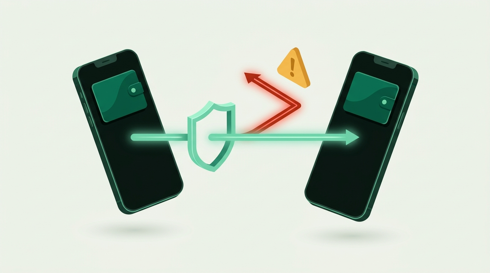

<div align="center">

# Vero — Cidadania Digital & Defesa contra Golpes

**Plataforma educativa interativa contra golpes digitais no Brasil**  
Projeto de Extensão Universitária (**ACES · 4º Semestre de Engenharia de Software · CEUB**)

[](https://nextjs.org/)
[](https://react.dev/)
[](https://www.typescriptlang.org/)
[](https://github.com/fellipedecastro0/Vero)

[Acessar Repositório](https://github.com/fellipedecastro0/Vero) · [Minigames (`/treino`)](#-arena-de-minigames-treino) · [Vero Checa (`/checa`)](#-vero-checa-checa) · [Emergência (`/emergencia`)](#-emergência--cartilha-emergencia)

</div>

---

## Sobre o Projeto

O **Vero** nasceu como projeto de extensão universitária (**ACES — Atividades Curriculares de Extensão**) do curso de **Engenharia de Software do CEUB**, com o objetivo de **educar e conscientizar pessoas de qualquer idade** — especialmente idosos, famílias e pequenos comerciantes — a reconhecer golpes digitais antes do prejuízo.

Em vez de textos técnicos longos, o usuário aprende **na prática**, dentro de simuladores em formato de celular com linguagem acessível, **Modo Calmo** (fontes ampliadas, alto contraste e redução de animações) e **narração em voz alta em português (`pt-BR`)** via Web Speech API.

---

## Arena de Minigames (`/treino`)

Cada minigame simula uma tela real de celular, traz explicação passo a passo do porquê cada situação é golpe ou segura, salva o **Score de Proteção**, medalhas e ofensiva no navegador (`localStorage`), e permite compartilhar o resultado no WhatsApp com um familiar (**Guardião**) ou imprimir o **Selo Vero**.

<table>
  <tr>
    <td width="50%" align="center">
      
      <br />
      <b>1. Caça-Golpes (WhatsApp, SMS & Gmail)</b>
      <br />
      18 cenários divididos por nível (Iniciante, Intermediário e Avançado) com visual realista de WhatsApp, SMS e e-mail HTML, além de Raio-X automático das pistas suspeitas.
    </td>
    <td width="50%" align="center">
      
      <br />
      <b>2. Qual é o Site Verdadeiro?</b>
      <br />
      Comparação lado a lado entre domínios oficiais (Gov.br, Correios, Receita e Bancos) e clones quase idênticos, mostrando por que o cadeado HTTPS sozinho não garante segurança.
    </td>
  </tr>
  <tr>
    <td width="50%" align="center">
      
      <br />
      <b>3. Hora de Pagar (Pix & Boleto)</b>
      <br />
      Simulador de tela de confirmação bancária para treinar a conferência de recebedor real, CPF/CNPJ, banco emissor e código antes de digitar a senha.
    </td>
    <td width="50%" align="center">
      
      <br />
      <b>4. Ligação Suspeita (Falsa Central)</b>
      <br />
      Simulador com voz em português para praticar a reação segura em chamadas de falsa central de banco, suporte técnico, pedido de código SMS e lembretes reais.
    </td>
  </tr>
</table>

> **Modo Oficina ACE (`/treino?jogo=oficina`):** painel para facilitadores registrarem a evolução *Antes vs. Depois* dos participantes em oficinas presenciais, com exportação em **CSV** e impressão de ata.

---

## Vero Checa (`/checa`)

Ferramenta prática para tirar dúvidas na hora antes de clicar ou pagar:

| Ferramenta | O que analisa | Rota / Motor |
| --- | --- | --- |
| **Mensagem Suspeita** | Identifica gatilhos de urgência, pedido de Pix de número novo, promessas de prêmio e links encurtados | Heurística em `ChecaTool.tsx` |
| **Link URL** | Detecta falta de SSL (`http://`), truque com `@`, uso de IP direto, TLDs suspeitos (`.top`, `.xyz`, `.vip`) e termos bancários falsos | `POST /api/check-url` |
| **Pix / Boleto** | Decodifica BR Code Pix (EMVCo), valida checksum **CRC-16 CCITT**, compara beneficiário esperado e lê linha digitável FEBRABAN (47/48 dígitos) | `src/lib/emv-parser.ts` + `POST /api/validate-pix` |
| **Vazamentos & Senhas** | Consulta exposições conhecidas e calcula resistência a força bruta com privacidade *k-Anonymity* | `POST /api/check-leak` + `src/lib/entropy.ts` |

---

## Emergência & Cartilha (`/emergencia`)

- **Protocolo de Socorro Imediato:** passo a passo com leitura por voz para 4 urgências (*Pix enviado por golpe / MED*, *WhatsApp clonado*, *Clique em link / senha digitada* e *Ligação de falsa central*).
- **Blindagem Rápida do Celular:** checklist interativo em 5 passos (verificação em 2 etapas no WhatsApp, limite noturno do Pix, filtro de chamadas, ocultar prévia de SMS e contato guardião).
- **Cartilha Ilustrada de Bolso:** resumo dos principais golpes em circulação no Brasil, com botão de áudio e atalho direto para treinar o golpe no minigame correspondente:

<table>
  <tr>
    <td width="33%" align="center">
      
      <br /><sub><b>Falso Parente (WhatsApp)</b></sub>
    </td>
    <td width="33%" align="center">
      
      <br /><sub><b>Falsa Central & Mão Fantasma</b></sub>
    </td>
    <td width="33%" align="center">
      
      <br /><sub><b>Golpe do Pix Errado (MED)</b></sub>
    </td>
  </tr>
  <tr>
    <td width="33%" align="center">
      
      <br /><sub><b>Falsa Taxa de Entrega</b></sub>
    </td>
    <td width="33%" align="center">
      
      <br /><sub><b>Boleto Adulterado</b></sub>
    </td>
    <td width="33%" align="center">
      
      <br /><sub><b>Roubo de Código SMS</b></sub>
    </td>
  </tr>
</table>

---

## Acessibilidade & Inclusão

- **Modo Calmo (`Modo calmo` no cabeçalho):** amplia tipografia, aumenta contraste e reduz transições bruscas.
- **Controle de Voz Global:** narração automática em português (`pt-BR`) com opção **Silenciar / Sem voz** no cabeçalho e botões manuais **"Ouvir"** nas telas de simulador e emergência.
- **Impressão limpa (`@media print`):** impressão dedicada do **Selo Vero** e da **Ata de Oficina ACE**.

---

## Estrutura do Projeto

```text
src/
├── app/
│   ├── page.tsx                  # Página inicial (vitrine e atalhos)
│   ├── treino/page.tsx           # Hub e arenas dos 4 minigames + Oficina ACE
│   ├── checa/page.tsx            # Vero Checa (Mensagem, Link, Pix/Boleto e Vazamentos)
│   ├── emergencia/page.tsx       # Socorro imediato, Blindagem Rápida e Cartilha
│   ├── sobre/page.tsx            # Arquitetura e documentação do projeto ACES
│   └── api/
│       ├── check-url/route.ts    # Análise heurística de links suspeitos
│       ├── check-leak/route.ts   # Consulta didática de vazamentos e senhas
│       └── validate-pix/route.ts # Validação Pix EMV / CRC-16
├── components/                   # Header, Footer, PhoneArenaShell e simuladores
├── lib/                          # Parser EMV/FEBRABAN, desafios, fala e progresso
└── types/                        # Tipos TypeScript
```

---

## Como Executar Localmente

Pré-requisitos: **Node.js 20+** e **npm**.

```bash
# 1. Clonar o repositório
git clone https://github.com/fellipedecastro0/Vero.git
cd Vero

# 2. Instalar dependências
npm install

# 3. Rodar em modo desenvolvimento
npm run dev
```

Abra [http://localhost:3000](http://localhost:3000) no navegador.

### Scripts úteis

```bash
npm run dev    # Servidor local de desenvolvimento
npm run build  # Build de produção (Next.js)
npm run start  # Servir build de produção
npm run lint   # Verificação ESLint
```

---

## Autores & Extensão

- **Autores:** Fellipe de Castro & Jhonatgan Magalhães
- **Curso:** Engenharia de Software · 4º Semestre (**CEUB**)
- **Projeto:** ACES — Atividades Curriculares de Extensão · *Vero Cidadania Digital*
